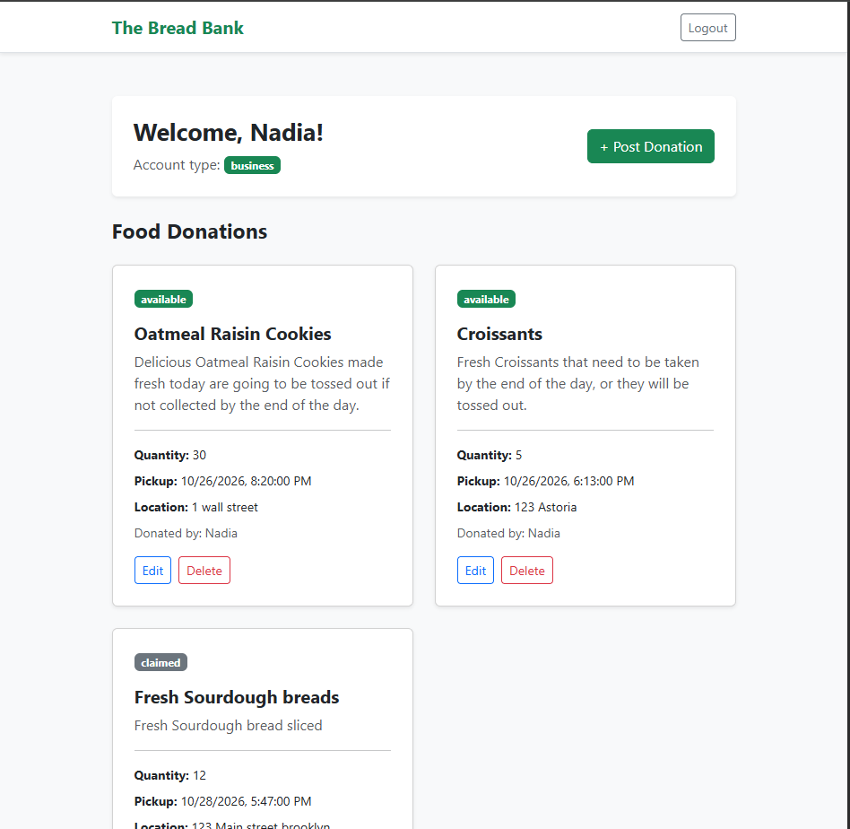

# Bread Bank — Community Food Donation Platform

Bread Bank is a full-stack web application that connects businesses with individuals and community organizations to reduce food waste and make surplus food accessible.

Businesses can post available food donations with photos and pickup information, while recipients can browse listings and claim donations.

## Project Preview



*Bread Bank application preview.*

## Features

- **User Authentication:** Secure registration and login with business and recipient accounts.
- **Role-Based Access:** Different functionality for businesses and recipients.
- **Donation Management:** Businesses can create, edit, and delete food listings.
- **Photo Uploads:** Add food photos to donation listings using Multer.
- **Donation Claims:** Recipients can reserve available food donations.
- **Claim Tracking:** MongoDB tracks donation availability and recipient claims.
- **Responsive UI:** Mobile-friendly interface built with Bootstrap.

## Tech Stack

**Frontend:** HTML, CSS, EJS, Bootstrap 5

**Backend:** Node.js, Express.js

**Database:** MongoDB Atlas, Mongoose

**Authentication:** Express Session, bcryptjs

**File Uploads:** Multer

**Architecture:** MVC (Model-View-Controller)

## Getting Started

Clone the repository and install dependencies:

```bash
git clone https://github.com/YOUR_USERNAME/breadbank.git
cd breadbank
npm install
```

Create a `.env` file:

```env
PORT=3002
MONGODB_URI=your_mongodb_connection_string
SESSION_SECRET=your_secure_session_secret
```

Start the application:

```bash
npm run dev
```

Open `http://localhost:3002` in your browser.

## Future Improvements

- Email notifications for donation claims
- Pickup scheduling and confirmation
- Location-based donation searches
- Cloud storage for uploaded images
- Donation history and analytics

## Author

**Anwar Alshohatee** — Software Engineer

[GitHub](https://github.com/AnwarAlshohatee)